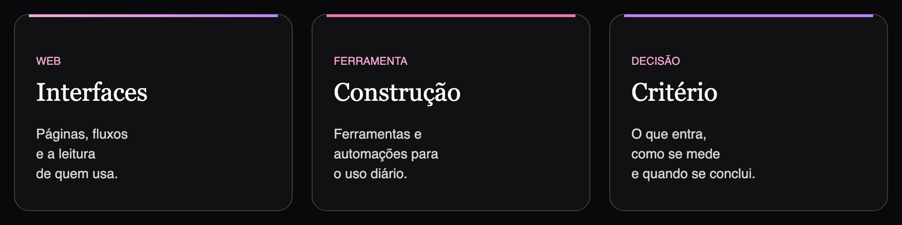

  

  

  
  
  
  
  
  
  
  

  4º período de Ciência da Computação na UFCG · monitoria ativa de Lógica de Programação
   
  
  

De dezembro de 2025 a outubro de 2026, atuei na **Severino Biu**. Desde abril de 2026, atuo na [**SIP — Santana Inteligência Política**](https://www.santanainteligencia.com.br/). Criei do zero alguns sites e algumas ferramentas, e uma delas entrou na rotina do time. Nas partes do produto em que atuo, trabalho em equipe, conduzo projetos e ideias, cuido da UI/UX e desenho fluxos de automação. Como aluna de Ciência da Computação, trabalho com ferramentas de inteligência artificial, com revisão humana antes de a saída ser tratada como concluída. Participo da decisão do que a tela mostra, de como o número é contado e de quando um fluxo pode ser concluído.

  

Técnica em Edificações pelo IFPB. Medalha de ouro na MOBFOG, 43ª Jornada de Foguetes, e Cientista Mirim Honorária pelo projeto Caravana Espacial.

Os números abaixo contam só o que este GitHub deixa público. O ano na SIP está em repositório privado. `dio-java-basico` e `dio-lab-open-source` são exercícios de curso.

  

